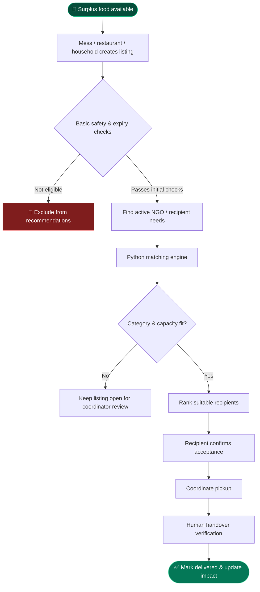
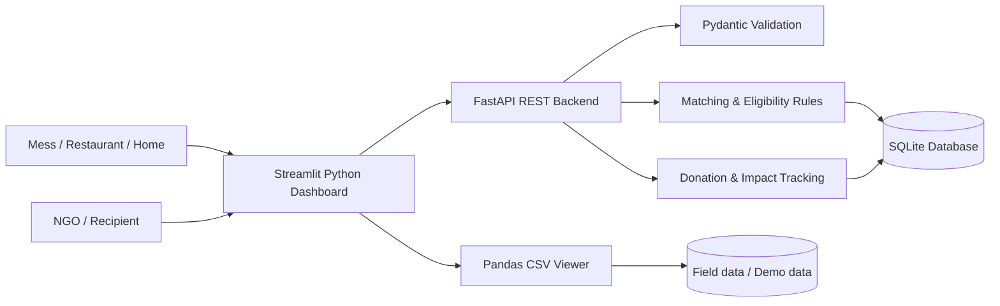

<div align="center">


<a href="https://github.com/saniya-dogra/mess2meal"></a>


<br/><br/>

**A community-first food rescue platform connecting surplus meals from college messes, restaurants, cafeterias and households with NGOs and people who need them.**


</div>

---

## 🌱 The problem we're solving

A college mess may prepare more food than students consume. A restaurant may have safe surplus near closing time. A household may have extra freshly prepared food. Meanwhile, local NGOs, shelters and community groups may need meals.

**Mess2Meal is a Python-based coordination tool** that helps record surplus food, identify potentially suitable recipients and track the donation journey.

> **Evidence transparency:** This repository includes a clearly labeled synthetic dataset for software demonstrations. It is not fieldwork evidence. The assignment's real observations, interview, photos and reflection must be collected and written by the project author.

## ✨ The journey

<div align="center">

| 🍲 FOOD SOURCES | ♻️ MESS2MEAL | 💚 PEOPLE |
|:---:|:---:|:---:|
| College messes | Validate & list | NGOs |
| Restaurants | Match & prioritise | Shelters |
| Cafeterias | Track handover | Community kitchens |
| Households | Measure delivered food | People in need |

</div>

## 🎬 How it works



## 🏛️ System architecture



## 🧠 Smart matching — transparent, not a black box

The current matching engine:

1. Excludes expired food and listings marked unavailable.
2. Excludes blank or explicitly unsafe storage-condition descriptions.
3. Filters out inactive recipients.
4. Checks food-category preference and recipient capacity.
5. Prioritises by urgency and coordinator-entered distance.
6. Returns a score with human-readable reasons.

**Food safety comes first:** this is only a preliminary software filter. It does not inspect, certify or guarantee that food is safe. A responsible human coordinator must verify preparation, storage, transport, recipient details and applicable food-safety requirements before every handover.

## 🧰 Tech stack

<div align="center">


</div>

| Technology | Role |
|---|---|
| Python 3.10+ | Entire application and business logic |
| FastAPI | REST backend |
| Streamlit | Interactive dashboard |
| SQLite | Local persistence |
| Pydantic | Request validation |
| Pandas | CSV loading and analysis |
| Pytest | Unit tests |
| Mermaid | Architecture and workflow diagrams |

## 🗂️ Repository structure

```text
mess2meal/
├── app/
│   ├── main.py                 # Streamlit dashboard
│   └── api/
│       ├── main.py             # FastAPI routes
│       ├── schemas.py          # Pydantic models
│       ├── database.py         # SQLite setup
│       ├── matching.py         # Eligibility & ranking
│       └── services.py         # Data operations
├── data/
│   ├── data.csv                # Your real field observations
│   ├── demo_data.csv           # 24 synthetic demo rows
│   └── README.md
├── docs/
│   ├── architecture.md
│   └── flowcharts/
│       └── donation-lifecycle.mmd
├── assets/                     # App screenshots & permitted photos
├── tests/
│   └── test_matching.py
├── ai-chats/                   # Actual AI chat exports
├── research.md
├── fieldwork.md
├── reflection.md
├── requirements.txt
└── README.md
```

## 🚀 Run it locally

### 1. Clone the repository

```bash
git clone https://github.com/saniya-dogra/mess2meal.git
cd mess2meal
```

### 2. Create an environment and install dependencies

```bash
python -m venv .venv

# Windows PowerShell
.venv\Scripts\Activate.ps1

# macOS / Linux
source .venv/bin/activate

pip install -r requirements.txt
```

### 3. Start the backend

```bash
uvicorn app.api.main:app --reload
```

Open **http://127.0.0.1:8000/docs** for interactive Swagger API documentation.

### 4. Start the dashboard (new terminal)

```bash
streamlit run app/main.py
```

### 5. Run tests

```bash
pytest -v
```

## 🔌 API endpoints

| Method | Endpoint | Description |
|:---:|---|---|
| GET | `/health` | Backend health check |
| POST | `/food` | Create surplus food listing |
| GET | `/food` | View food listings |
| POST | `/recipients` | Register NGO / recipient |
| GET | `/recipients` | View recipients |
| GET | `/food/{food_id}/matches` | Get ranked recipient suggestions |
| PATCH | `/food/{food_id}/status` | Update donation lifecycle status |
| GET | `/impact` | View confirmed delivery totals |

## 📊 Data: real observations vs demo records

Two separate files are intentionally maintained:

| File | Purpose | Can it count as assignment fieldwork? |
|---|---|---|
| [`data/data.csv`](data/data.csv) | Your own observations from the actual location | **Yes, only after you collect and document them** |
| [`data/demo_data.csv`](data/demo_data.csv) | 24 synthetic example rows across messes, restaurants, cafes and households | **No — demo/testing only** |

The demo records use clearly marked example locations and a `SYNTHETIC_DEMO_ONLY` label. They are useful for trying CSV display and charts, but must never be presented as measured local data.

## 🖼️ Screenshots & demo

Add screenshots of your own running application to `assets/`:

| Suggested screenshot | What to capture |
|---|---|
| `dashboard-overview.png` | Main dashboard and navigation |
| `food-listing.png` | A test food listing |
| `matching-results.png` | Ranked recipient suggestions |
| `impact-dashboard.png` | Delivered-only impact metrics |

Add two timestamped photos from your real field visit only with permission. Do not use generated or stock images as proof of fieldwork.

**3-minute demo recording:** _Add your own recording link here after recording the working application._

## 🧪 Assignment evidence

- [Research notes](research.md) — complete with two sources you actually read.
- [Fieldwork record](fieldwork.md) — real visit, named/agreed contact, timestamped conversation and photos.
- [Data collection guide](data/README.md) — collect 20+ genuine observations.
- [Personal reflection](reflection.md) — write this yourself without AI.
- [AI chat exports](ai-chats/) — add the actual conversations used.

## ⚠️ Current limitations

- No GPS or automatic route optimisation; distance is coordinator-entered.
- No SMS, WhatsApp or live NGO notification integration.
- No automatic food-safety certification.
- SQLite is intended for a local prototype, not concurrent multi-location production.
- A suggested match does not mean the recipient accepted or food was delivered.
- Synthetic demo records do not establish real-world impact.

## 🔮 Future roadmap

- [ ] Role-based access for mess operators, NGO coordinators and administrators.
- [ ] Recipient verification and handover confirmation.
- [ ] Pickup windows and volunteer coordination.
- [ ] Multi-location database deployment.
- [ ] Privacy-aware impact reports and food rescue analytics.

---

<div align="center">

### 💚 One listing can become someone's meal.

**Mess2Meal — Don't waste it. Share it.**

<a href="https://github.com/saniya-dogra/mess2meal"></a>


</div>
