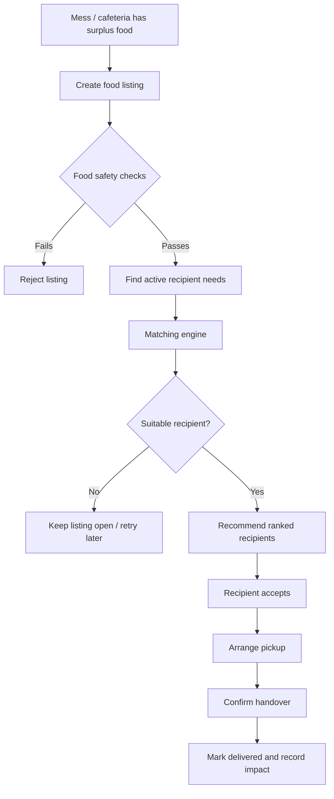
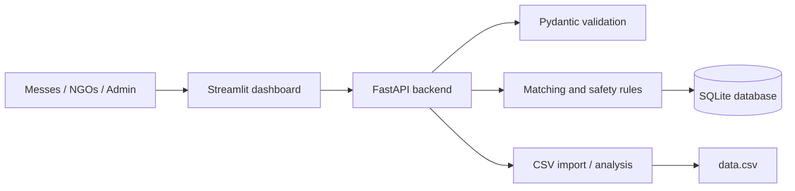

# 🍱 Mess2Meal — Turning Surplus Food into Shared Meals

<p align="center">
  <strong>Rescue surplus food. Connect it to people who need it. Reduce avoidable food waste.</strong>
</p>

<p align="center">
  
  
  
  
  
</p>

<p align="center">
  <em>A Python-based food-rescue coordination tool for messes, cafeterias, NGOs and local recipient groups.</em>
</p>

---

## 🌍 The idea

Food prepared in college messes and cafeterias can remain surplus at the end of a meal. At the same time, nearby NGOs and community groups may be looking for meals. **Mess2Meal** is designed to make that connection easier through a simple, traceable workflow.

> **Important:** This repository contains the software MVP. The local problem, named field contact, timestamped photos, conversation notes and 20+ real observations must be completed by the project author. No fieldwork or impact figures are fabricated here.

## ✨ What it does

- **Surplus food listing:** record food name, quantity, preparation time, best-before time, storage condition and pickup location.
- **Recipient registration:** record NGO/community requirements, capacity, preferred food categories and location.
- **Rule-based matching:** rank eligible recipients using availability, quantity fit, distance supplied by the operator and urgency.
- **Food-safety guardrails:** expired, unsafe, or incomplete listings are excluded from recommendations.
- **Donation lifecycle:** track listed, matched, accepted, picked-up and delivered states.
- **CSV analysis:** import locally collected observations and view useful summaries.
- **Audit-friendly records:** keep donation and matching records in SQLite.

## 🧭 End-to-end flow



## 🏗️ Architecture



### Technology stack

| Layer | Technology | Purpose |
|---|---|---|
| Language | Python 3.10+ | Entire application logic |
| Dashboard | Streamlit | Python-native user interface |
| Backend | FastAPI | REST API |
| Validation | Pydantic | Validate incoming data |
| Database | SQLite | Local persistent records |
| Data analysis | Pandas | CSV loading and summaries |
| Testing | Pytest | Automated tests |
| API docs | Swagger UI | Interactive API documentation |

## 📁 Project structure

```text
mess2meal/
├── app/
│   ├── __init__.py
│   ├── main.py                 # Streamlit dashboard
│   └── api/
│       ├── __init__.py
│       ├── main.py             # FastAPI entry point
│       ├── schemas.py          # Request / response models
│       ├── database.py         # SQLite setup and queries
│       ├── matching.py         # Recipient ranking logic
│       └── services.py         # Donation workflows
├── data/
│   ├── data.csv                # Add 20+ personally collected rows
│   └── README.md               # Data collection instructions
├── docs/
│   ├── architecture.md
│   └── flowcharts/
│       └── donation-lifecycle.mmd
├── assets/
│   └── README.md               # Add your own fieldwork photos here
├── tests/
│   ├── test_matching.py
│   └── test_api.py
├── ai-chats/
│   └── README.md               # Export actual AI chats here
├── research.md
├── fieldwork.md
├── reflection.md
├── requirements.txt
├── .gitignore
└── README.md
```

## ⚙️ Run locally

### 1. Clone and install

```bash
git clone https://github.com/saniya-dogra/mess2meal.git
cd mess2meal
python -m venv .venv
# Windows
.venv\Scripts\activate
# macOS / Linux
source .venv/bin/activate
pip install -r requirements.txt
```

### 2. Start the backend

```bash
uvicorn app.api.main:app --reload
```

- API base: http://127.0.0.1:8000
- Swagger docs: http://127.0.0.1:8000/docs
- Health check: http://127.0.0.1:8000/health

### 3. Start the dashboard (second terminal)

```bash
streamlit run app/main.py
```

### 4. Run tests

```bash
pytest -q
```

## 🔌 API endpoints

| Method | Endpoint | Purpose |
|---|---|---|
| GET | `/health` | Service health |
| POST | `/food` | Create a surplus listing |
| GET | `/food` | List food listings |
| POST | `/recipients` | Register an NGO / recipient |
| GET | `/recipients` | List recipients |
| GET | `/food/{food_id}/matches` | Ranked eligible recipients |
| PATCH | `/food/{food_id}/status` | Update donation status |
| GET | `/impact` | Delivered-food summary |

## 🧠 Matching logic

The MVP uses transparent rules rather than an opaque AI model:

1. Exclude listings that are expired, unsafe, unavailable or missing safety-critical information.
2. Consider only active recipients whose needs overlap with the food category.
3. Check that recipient capacity can accommodate the offered quantity.
4. Rank eligible recipients by operator-entered distance and urgency.
5. Return the reasons behind each recommendation.

The score is a prioritisation aid, **not a food-safety certification or a guarantee of delivery**. A human coordinator must verify food condition, recipient details, transport and local food-safety requirements before handover.

## 📊 Real data and fieldwork

This assignment requires at least 20 observations collected by the author. The starter `data/data.csv` contains headers only. Do not submit invented rows as field data.

- [Research notes](research.md)
- [Fieldwork record and photo checklist](fieldwork.md)
- [CSV collection guide](data/README.md)
- [Reflection — author must write this without AI](reflection.md)

### Results

Add your actual run output here after entering and validating your own data:

| Measure | Actual result |
|---|---:|
| Observations collected | Not yet recorded |
| Food listings entered | Not yet recorded |
| Eligible matches found | Not yet recorded |
| Food confirmed delivered (kg) | Not yet recorded |

## 🖼️ Screenshots and demo

Add screenshots captured from your running application in `assets/`. Add two timestamped, genuine fieldwork photos only with permission and without exposing private information.

**3-minute screen recording:** _Add your recording link after recording the real application._

## ⚠️ Current limitations

- No live GPS, route optimisation, SMS or WhatsApp integration.
- Distance is entered by the coordinator; it is not fetched from an external API.
- Food safety is not automatically certified. Human inspection and local rules remain mandatory.
- The current database is local SQLite, suitable for a prototype rather than multi-site production.
- A recommendation does not confirm recipient acceptance or successful delivery.
- Real-world results are not claimed until fieldwork and operational use are documented.

## 🛣️ Future improvements

- Role-based access for mess operators, NGO coordinators and administrators.
- Verified recipient onboarding and handover confirmation.
- Pickup time windows and volunteer assignment.
- Multi-location deployment with PostgreSQL.
- Privacy-conscious reporting of meals rescued and waste avoided.

## 🤝 Contributing

For this take-home assignment, keep the evidence authentic: collect your own observations, record your own interview, capture your own photos, and write your own reflection.

## 📄 License

For educational / prototype use. Add a formal license before permitting reuse.
