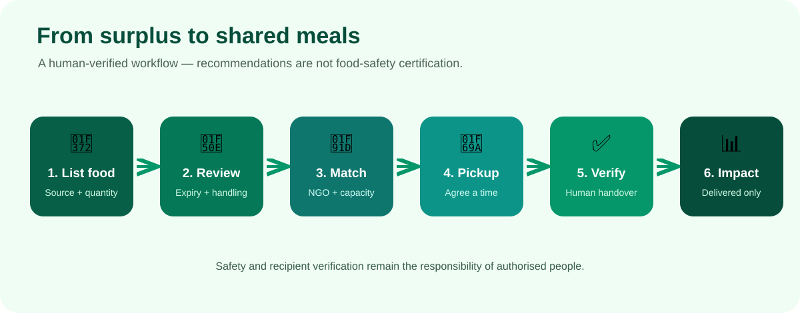
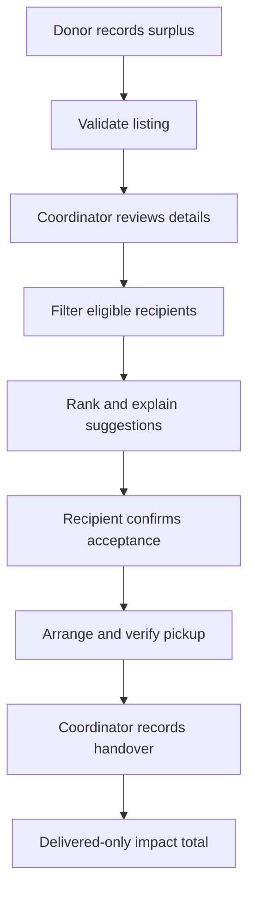
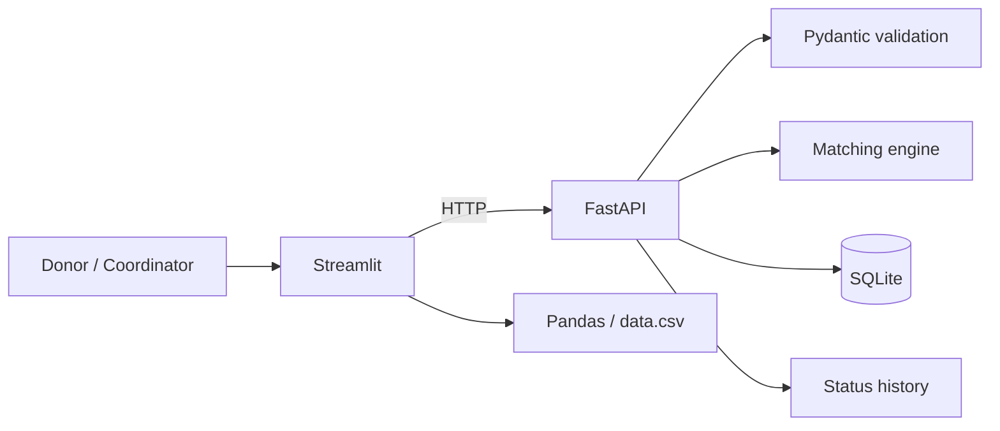

# 🍱 Mess2Meal

<div align="center">



**List surplus. Match recipients. Track handovers.**

[](https://python.org/)
[](https://fastapi.tiangolo.com/)
[](https://streamlit.io/)
[](https://sqlite.org/)
[](https://pytest.org/)

</div>

---

## 🌿 About

Surplus food can arise in college messes, hostels, restaurants, cafeterias and households. Coordinating a responsible handover requires more than publishing an offer: quantity, preparation time, handling information, recipient capacity and pickup arrangements matter.

Mess2Meal is a local-first prototype that structures these steps through a Streamlit dashboard, FastAPI backend and SQLite database.

> **Scope:** This is a software coordination prototype, not a live food-rescue service. It does not inspect food, certify safety, verify recipient organisations, arrange transport or prove a completed donation.

## ✨ Features

- **Food listings:** record food, category, quantity, preparation/best-before times, storage description and pickup location.
- **Recipient records:** store recipient preferences, capacity, urgency, availability and coordinator-entered distance.
- **Explainable matching:** filter by listing status, expiry, storage-description flags, recipient activity, category and capacity; return score reasons.
- **Status lifecycle:** record allowed workflow transitions and a timestamped status history.
- **Delivered-only impact:** count quantity only after a listing reaches the delivered state.
- **CSV explorer:** inspect the labelled demonstration dataset and compare source categories.

## 🧭 Workflow





## 🏗️ Architecture



| Layer | Technology | Role |
|---|---|---|
| UI | Streamlit | Forms, listing views, charts |
| API | FastAPI | Validated endpoints |
| Validation | Pydantic | Field and timestamp constraints |
| Logic | Python | Eligibility and ranking |
| Storage | SQLite | Food, recipient and audit records |
| Data | Pandas | CSV demonstration view |
| Tests | Pytest | Matching and service regression tests |

## 🧠 Matching logic

A listing is considered only when it is available, has a future best-before timestamp and includes a non-empty storage description without configured warning terms. Recipients must be active, have enough capacity and accept the food category (or all categories).

Eligible recipients receive a transparent heuristic score based on urgency, coordinator-entered distance and capacity. The API returns reasons behind each score. The score is a prioritisation aid only; it is not a safety rating or a promise of collection.

## 🔁 Status lifecycle and audit history

```text
available -> matched -> accepted -> picked_up -> delivered
     |           |          |
     +-> cancelled <--------+
                 matched -> available (re-open)
```

Every status change is recorded by the API. Invalid jumps (for example, available directly to delivered) return HTTP 409. The history endpoint is GET /food/{food_id}/history.

## 🧰 Tech stack

Python 3.10+, FastAPI, Uvicorn, Streamlit, Pydantic v2, SQLite, Pandas, Requests and Pytest.

## 📁 Repository layout

```text
mess2meal/
├── app/
│   ├── main.py
│   └── api/
│       ├── main.py
│       ├── database.py
│       ├── schemas.py
│       ├── services.py
│       └── matching.py
├── assets/
├── data/
│   ├── data.csv
│   └── README.md
├── docs/
│   ├── architecture.md
│   ├── demo-script.md
│   └── quality-checklist.md
├── tests/
├── ai-chats/
├── research.md
├── fieldwork.md
├── reflection.md
└── requirements.txt
```

## 🚀 Run locally

### 1. Clone and enter the project

```bash
git clone https://github.com/saniya-dogra/mess2meal.git
cd mess2meal
```

### 2. Create a virtual environment

**Windows PowerShell**
```powershell
python -m venv .venv
.venv\Scripts\Activate.ps1
```

**macOS / Linux**
```bash
python3 -m venv .venv
source .venv/bin/activate
```

### 3. Install dependencies

```bash
python -m pip install --upgrade pip
pip install -r requirements.txt
```

### 4. Start the API

```bash
uvicorn app.api.main:app --reload
```

- Health check: http://127.0.0.1:8000/health
- Interactive API docs: http://127.0.0.1:8000/docs

### 5. Start the dashboard in a second terminal

```bash
streamlit run app/main.py
```

### 6. Run automated tests

```bash
pytest -q
```

## 🔌 API reference

| Method | Endpoint | Purpose |
|---|---|---|
| GET | /health | API status |
| POST | /food | Create food listing |
| GET | /food | List food listings |
| POST | /recipients | Create recipient |
| GET | /recipients | List recipients |
| GET | /food/{food_id}/matches | Ranked recipient suggestions |
| PATCH | /food/{food_id}/status | Record an allowed status transition |
| GET | /food/{food_id}/history | View status audit history |
| GET | /impact | Delivered-only totals |

### Example status update

```json
{
  "status": "matched",
  "note": "Coordinator reviewed the suggested recipient"
}
```

## 📊 Dataset and provenance

data/data.csv currently contains 24 **synthetic demonstration records** across college mess, hostel mess, restaurant, cafe/bakery, canteen and household categories. Every row is marked SYNTHETIC_DEMO_ONLY.

These records are included to test CSV loading and visualisation. They are not real observations, donors, NGO partnerships, collected quantities or completed deliveries. Do not report their totals as actual impact.

See [data/README.md](data/README.md) for the data dictionary and quality rules.

## 🧪 Fieldwork status — primary evidence still required

The five-line problem statement in [research.md](research.md) is a **provisional hypothesis**, not a claim of personal observation. The repository does not yet contain verified local fieldwork, an interview, timestamped visit photos or 20 genuine observations.

- [Fieldwork workbook](fieldwork.md): visit log, 20-observation table, interview questions, three-statement record, surprising observation and photo log.
- [Blank 20-row fieldwork CSV template](data/fieldwork-template.csv): fill only with entries collected in person.
- The current [data/data.csv](data/data.csv) remains synthetic demo data and must not be submitted as real field evidence.

Do not claim the assignment's primary-research requirements are complete until the real visit and conversation have happened and the evidence has been added with permission.

## 📚 Documentation

- [Secondary research](research.md)
- [20 findings from published research](research-observations.md)
- [Fieldwork record — owner completion required](fieldwork.md)
- [Personal reflection — first-person draft to review](reflection.md)
- [System architecture](docs/architecture.md)
- [Three-minute demo recording guide](docs/demo-script.md)
- [Release and evidence checklist](docs/quality-checklist.md)
- [AI-assisted development notes](ai-chats/README.md)
- [Visual asset notes](assets/README.md)

## 🎬 Demo recording

**Recording link: NOT RECORDED.** Record the actual running application and add its shareable link here. Follow [the three-minute demo script](docs/demo-script.md). Do not substitute the dashboard concept illustration for a real screen recording.

## 🖼️ Actual application screenshots

**Screenshots: NOT ADDED.** Add genuine screenshots after running the Streamlit app. SVG files in assets/ are illustrations, not screenshots of a running application.

## ⚠️ Current limitations

- No login, role-based access or organisation verification.
- Distance is entered by the coordinator; there is no GPS or route optimisation.
- No SMS/WhatsApp notifications or automated pickup scheduling.
- SQLite is intended for local demonstration, not multi-user production deployment.
- Storage text filters are basic and cannot establish safe handling.
- Status changes are coordinator-entered; the app cannot verify physical handover.
- The included CSV is synthetic, not primary fieldwork.

## 🛣️ Next steps

- [ ] Add authentication and role-based permissions.
- [ ] Verify recipient organisations and refresh capacity/availability.
- [ ] Add consent-based notifications and pickup scheduling.
- [ ] Deploy with a managed database, backups and monitoring.
- [ ] Validate the workflow with real stakeholders before operational use.

---

<div align="center">

**💚 Mess2Meal — Rescue surplus. Coordinate responsibly.**

<sub>Python · FastAPI · Streamlit · SQLite</sub>

</div>
