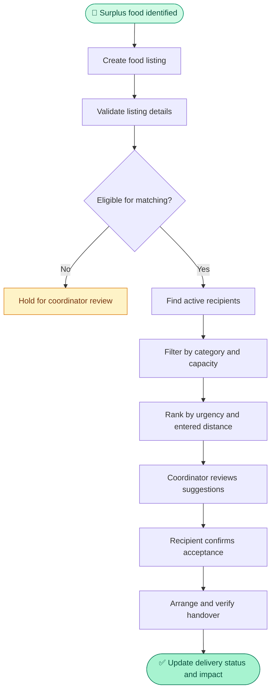
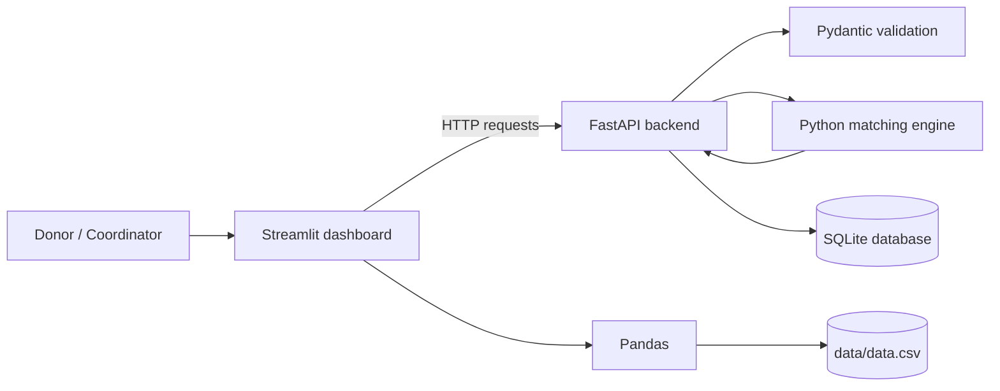

<div align="center">


### A smarter way to coordinate surplus food

**A Python-based food rescue and redistribution coordination prototype**


[](https://python.org/)
[](https://fastapi.tiangolo.com/)
[](https://streamlit.io/)
[](https://sqlite.org/)
[](https://pytest.org/)

</div>

---

## 🌿 About the project

Food prepared by college messes, hostels, restaurants, cafeterias and households can remain unused while NGOs, shelters and community kitchens may need timely food support. Coordinating a donation involves more than posting an offer: quantity, preparation time, storage details, recipient capacity and pickup timing all matter.

**Mess2Meal** brings these coordination steps into one simple workflow. Food providers can create surplus listings, coordinators can review potential recipients, and delivery status can be tracked in one place.

> **Project scope:** Mess2Meal is a working-style local prototype and coordination aid. It does not certify food safety, independently verify organisations or arrange physical transport.

## ✨ What Mess2Meal offers

<table>
<tr>
<td width="50%" valign="top">

### 🍲 Food listings
- Add surplus food details
- Record quantity and category
- Add preparation and best-before time
- Provide storage and pickup information

</td>
<td width="50%" valign="top">

### 🤝 Recipient registration
- Register recipient groups
- Set food-category preferences
- Record capacity and urgency
- Mark current availability

</td>
</tr>
<tr>
<td width="50%" valign="top">

### 🧠 Explainable matching
- Filter inactive recipients
- Check capacity and category fit
- Prioritise by urgency and distance
- Show reasons behind suggestions

</td>
<td width="50%" valign="top">

### 📊 Impact tracking
- View food listings
- Track donation status
- Count delivered listings
- Summarise delivered quantity

</td>
</tr>
</table>

## 🔄 How the platform works




## 🏗️ System architecture



| Layer | Technology | Responsibility |
|---|---|---|
| User interface | Streamlit | Dashboard and forms |
| API | FastAPI | Food, recipient, matching and status endpoints |
| Validation | Pydantic | Request data validation |
| Business logic | Python | Eligibility checks and recipient ranking |
| Database | SQLite | Local data persistence |
| Data analysis | Pandas | CSV loading and dashboard summaries |
| Testing | Pytest | Automated test suite |

## 🧠 Matching logic

The matching engine uses transparent rules rather than an unexplained recommendation:

1. The food listing must be available and its best-before time must be in the future.
2. A missing storage description or one containing configured unsafe terms is excluded.
3. Only active recipients are considered.
4. Recipient capacity must be sufficient for the listed quantity.
5. Food category must match recipient preferences, unless the recipient accepts all categories.
6. Eligible recipients are ranked using urgency, coordinator-entered distance and capacity.
7. Each suggestion includes a score and human-readable reasons.

**Food safety note:** These are preliminary software filters, not food-safety inspection or certification. A responsible person must verify food condition, handling, recipient suitability and applicable requirements before redistribution.

## 🧰 Technology stack

<div align="center">


</div>

| Area | Tools |
|---|---|
| Language | Python 3.10+ |
| Backend | FastAPI, Uvicorn, Pydantic |
| Frontend | Streamlit |
| Database | SQLite |
| Data | Pandas, CSV |
| HTTP | Requests |
| Testing | Pytest, HTTPX |
| Diagrams | Mermaid |

## 📁 Project structure

```text
mess2meal/
├── app/
│   ├── main.py
│   └── api/
│       ├── main.py
│       ├── database.py
│       ├── matching.py
│       ├── schemas.py
│       └── services.py
├── assets/
│   ├── food-rescue-hero.svg
│   ├── donation-lifecycle.svg
│   └── dashboard-concept.svg
├── data/
│   ├── data.csv
│   └── README.md
├── docs/
│   ├── architecture.md
│   └── flowcharts/
├── tests/
├── ai-chats/
├── research.md
├── fieldwork.md
├── reflection.md
├── requirements.txt
└── README.md
```

## 🚀 Run locally

### 1. Clone the repository

```bash
git clone https://github.com/saniya-dogra/mess2meal.git
cd mess2meal
```

### 2. Create and activate a virtual environment

**Windows PowerShell**
```powershell
python -m venv .venv
.venv\Scripts\Activate.ps1
```

**macOS / Linux**
```bash
python3 -m venv .venv
source .venv/bin/activate
```

### 3. Install dependencies

```bash
python -m pip install --upgrade pip
pip install -r requirements.txt
```

### 4. Start the FastAPI backend

```bash
uvicorn app.api.main:app --reload
```

- API: http://127.0.0.1:8000
- Interactive Swagger documentation: http://127.0.0.1:8000/docs

### 5. Start the Streamlit dashboard

Open a second terminal with the virtual environment activated:

```bash
streamlit run app/main.py
```

### 6. Run tests

```bash
pytest -v
```

## 🔌 API endpoints

| Method | Endpoint | Description |
|:---:|---|---|
| GET | /health | API health check |
| POST | /food | Create a food listing |
| GET | /food | View food listings |
| POST | /recipients | Register a recipient |
| GET | /recipients | View recipients |
| GET | /food/{food_id}/matches | Get ranked recipient suggestions |
| PATCH | /food/{food_id}/status | Update donation status |
| GET | /impact | View delivered-only impact totals |

## 📊 Dataset and provenance

The file data/data.csv currently contains **24 synthetic demonstration records** across college messes, hostel messes, restaurants, cafes/bakeries, canteens and households. Every row is marked SYNTHETIC_DEMO_ONLY.

These examples help test CSV loading and dashboard charts. They are not measured food waste, real donor records, verified NGO partnerships or completed donations. Do not use their quantities as real-world impact figures.

See [data/README.md](data/README.md) for the data dictionary and provenance rules.

## 📚 Project documentation

| Document | Description |
|---|---|
| [Architecture](docs/architecture.md) | Components and application data flow |
| [Research](research.md) | Secondary research and design context |
| [Operational workflow](fieldwork.md) | Use case, operational requirements and validation boundaries |
| [Reflection](reflection.md) | Engineering decisions, limitations and next steps |
| [AI conversation log](ai-chats/README.md) | Development discussion and AI-assisted tasks |
| [Visual assets](assets/README.md) | SVG illustrations and usage notes |

## ⚠️ Current limitations

- Authentication and role-based access are not implemented.
- Recipient organisations are not independently verified.
- Distance is coordinator-entered; GPS and route optimisation are not implemented.
- No SMS, WhatsApp or automatic NGO notification integration.
- SQLite is used for local prototyping, not multi-tenant production deployment.
- Matching is not a food-safety decision.
- A suggested match is not proof of acceptance or delivery.

## 🛣️ Future roadmap

- [ ] Role-based login for donors, recipients and coordinators.
- [ ] Recipient verification and consent-based onboarding.
- [ ] Explicit acceptance, pickup and handover workflow.
- [ ] Notifications and pickup scheduling.
- [ ] Audit history for donation status changes.
- [ ] Production database and deployment.
- [ ] Privacy-aware impact reports based only on verified deliveries.

---

<div align="center">


### 💚 Mess2Meal

**Rescue surplus. Coordinate responsibly. Reduce avoidable food waste.**

<sub>Built with Python · A community-focused software prototype</sub>

</div>
