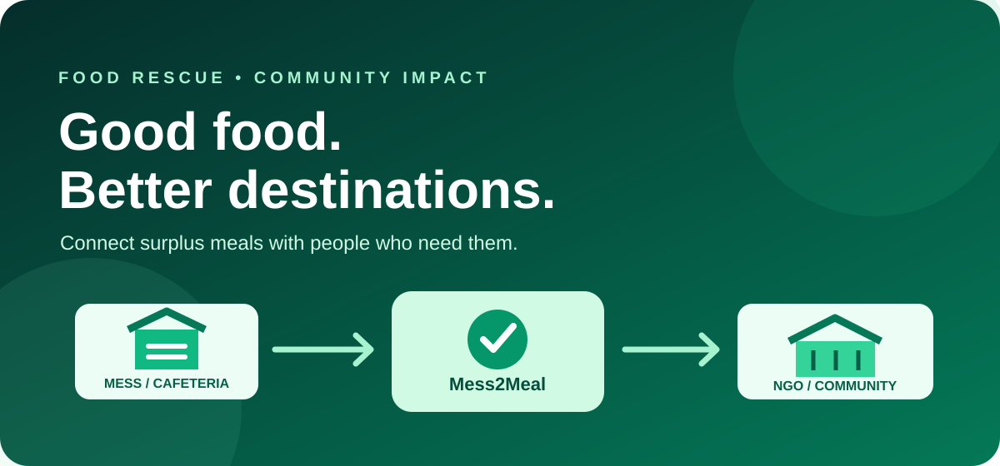
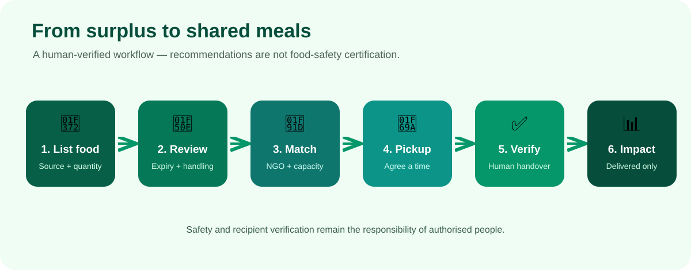
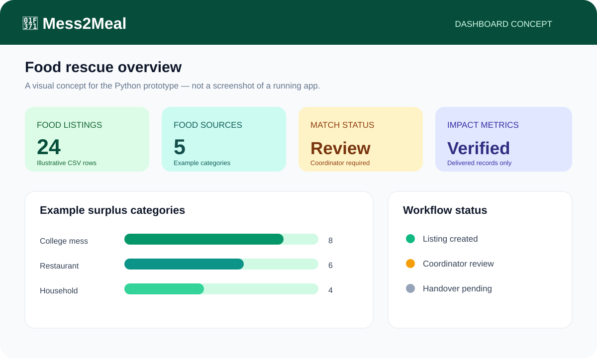

# Mess2Meal — visual assets

This folder contains original, project-specific SVG illustrations.

| File | Purpose |
|---|---|
| food-rescue-hero.svg | Hero illustration for the project and README |
| donation-lifecycle.svg | Six-stage food donation lifecycle infographic |
| dashboard-concept.svg | Conceptual dashboard mockup; not a screenshot of the running app |

## Preview
### Food rescue concept

### Donation lifecycle

### Dashboard concept

## Add genuine application screenshots
After running Streamlit locally, capture the actual dashboard and add screenshots such as dashboard-overview.png, food-listing.png, matching-results.png and impact-dashboard.png.

The dashboard concept SVG is an illustration only; it must not be described as a screenshot or proof that the UI is running.

## Fieldwork photos
Only add photos taken during a real visit and with permission. The SVG illustrations are not fieldwork photos and must not be used as evidence of an interview, visit or food donation.
