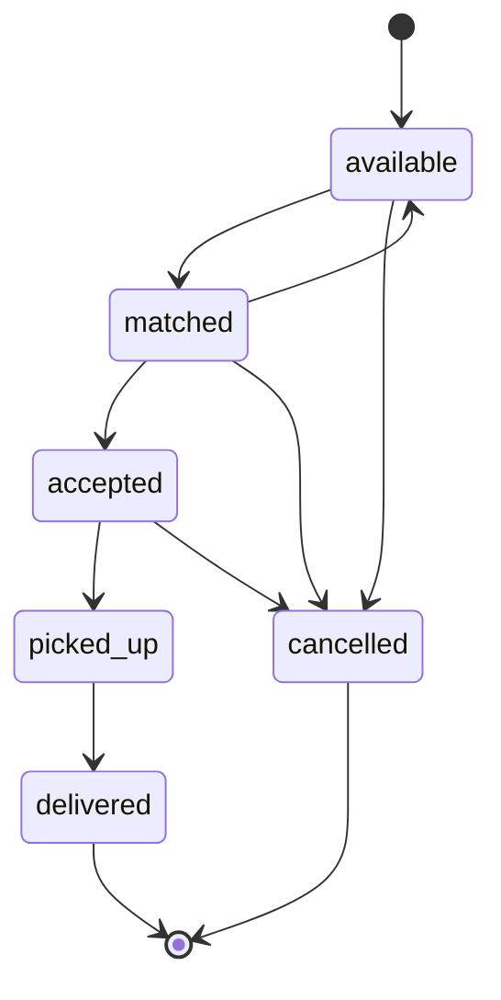

# Mess2Meal — system architecture

## Prototype boundary

Mess2Meal is a local coordination prototype. It records offers, stores recipient capacity and preferences, ranks possible recipients, and tracks manually confirmed status changes. It does not verify organisations, inspect food, arrange transport or certify food safety.

## Components

| Component | Responsibility |
|---|---|
| Streamlit dashboard | Food and recipient forms, listings, matching, impact and CSV exploration |
| FastAPI | Validated HTTP interface for the application |
| Pydantic | Input constraints and timezone-aware date validation |
| Matching module | Eligibility filters and explainable ranking |
| SQLite | Food, recipient and status-history persistence |
| Pandas | Reading and presenting the demonstration CSV |
| Pytest | Matching, persistence and workflow regression tests |

## Data flow

1. A donor or coordinator enters a food listing in Streamlit.
2. Streamlit sends the listing to FastAPI.
3. Pydantic validates required fields, quantity limits and timestamps.
4. The service stores the listing and writes its initial available event to status history.
5. The coordinator requests recipient suggestions.
6. The matching module filters expired/unavailable listings, incomplete or flagged storage descriptions, inactive recipients, category mismatches and insufficient capacity.
7. Eligible recipients are ranked by urgency, coordinator-entered distance and capacity. The API returns score reasons.
8. The coordinator records workflow transitions: available → matched → accepted → picked_up → delivered (or cancellation where allowed).
9. Every status change is recorded in status_history.
10. Only records in delivered state contribute to the impact endpoint.

## Status lifecycle

## Trust, safety and privacy

- Matching is a prioritisation aid, not a safety decision.
- Storage descriptions are donor-reported and do not prove temperature history or safe handling.
- A responsible person must verify food, packaging, transport and recipient suitability.
- Contact details are personal information; do not place them in public demo CSVs or screenshots.
- Demo records are synthetic and must never be counted as actual donations or meals served.

## Local persistence and migration

The app uses SQLite for a single-machine prototype. Startup creates missing tables and adds the recipient distance_km column to older databases. A production deployment would need authentication, role-based access, stronger audit controls, backups, managed database hosting and operational monitoring.
